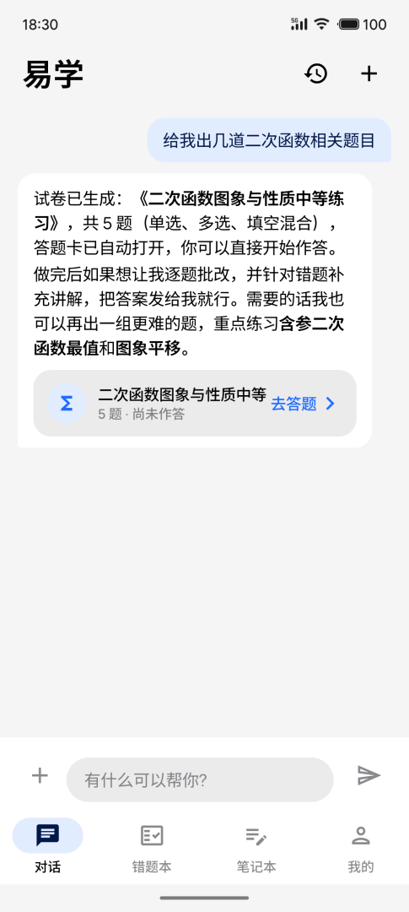
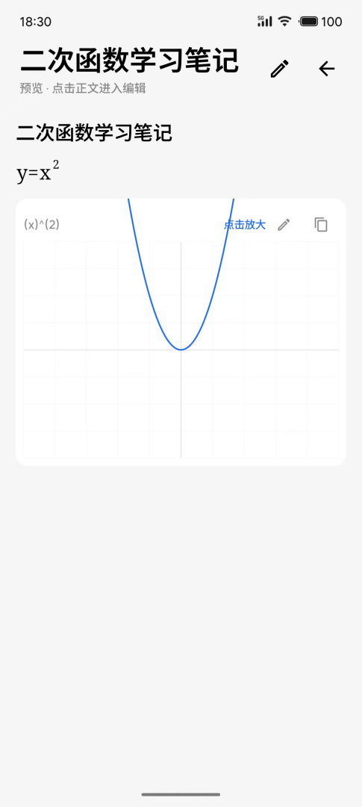
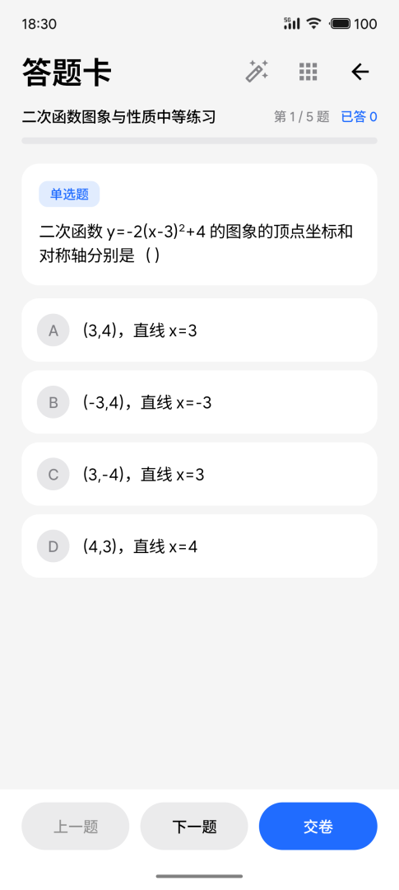
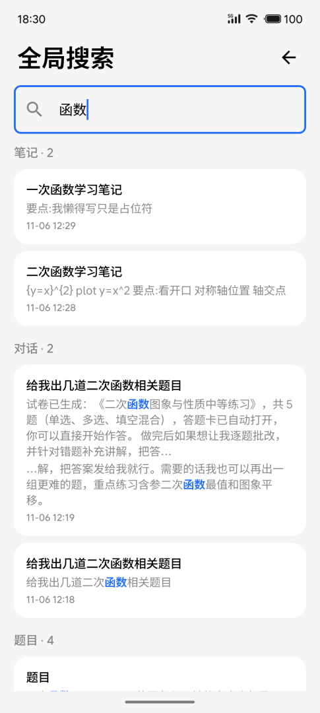

# 易学 (Yixue)

一个基于 AI 的学习助手 Android 应用。围绕「对话提问 → 出题练习 → 错题巩固 → 复习记忆」的学习闭环设计：

| 截图 | |
|---|---|
|  |  |
|  |  |

- **AI 对话**：流式回复，支持图片提问、函数图像、表格渲染；AI 可调用工具直接生成测验、写入笔记、检索教材原文
- **教材导入**：导入 PDF / Word 教材，自动分块；「与我使用的教材完全一致」模式下 AI 讲解基于教材原文
- **测验与错题本**：AI 出题、本地判分 + AI 复核；错题自动归档，支持 AI 精讲、错题重练、间隔复习提醒
- **笔记本**：Markdown 笔记，支持图片、公式与函数图卡片；全局搜索贯通笔记 / 对话 / 题目 / 教材
- **学习统计**：答题量、正确率趋势与错题科目分布
- **数据备份**：全部数据一键导出 / 恢复（ZIP，API 密钥不落备份文件）

## 构建

```powershell
# 需要 Android Studio 或 JDK 17+（项目使用 kapt，Kotlin 2.0.21）
.\gradlew.bat :app:assembleDebug
.\gradlew.bat :app:assembleRelease   # release 已启用 R8 + 资源收缩
```

首次使用需在「我的 → AI 服务设置」中配置一个 OpenAI 兼容接口（DeepSeek / 硅基流动 / 智谱 / Kimi / 通义 / OpenAI 模板可选）。

## 技术栈

Kotlin 2.0 + Jetpack Compose (Material 3) + Room + Navigation Compose + WorkManager + pdfbox-android，手写依赖注入（无 DI 框架）。

## 许可证

本项目采用 [PolyForm Noncommercial 1.0.0](./LICENSE) 许可证发布。

- 允许任何人出于**个人学习、研究、娱乐等非商业目的**使用、修改和分发本项目
- **禁止商业使用**。商业授权（包括但不限于集成、二次分发、商业发行）由版权所有者单独授予
- 版权所有者本人不受本许可证约束，保留对本项目的全部权利，包括商业使用与商业授权

如需商业授权，请通过 GitHub Issues 联系作者。
